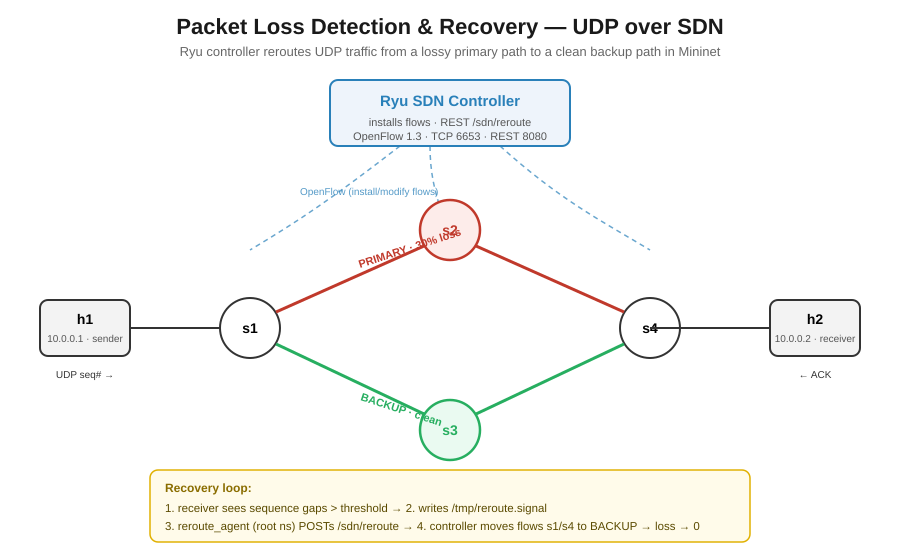
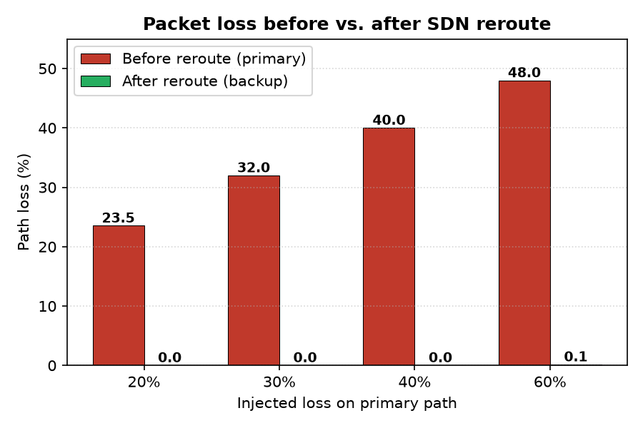
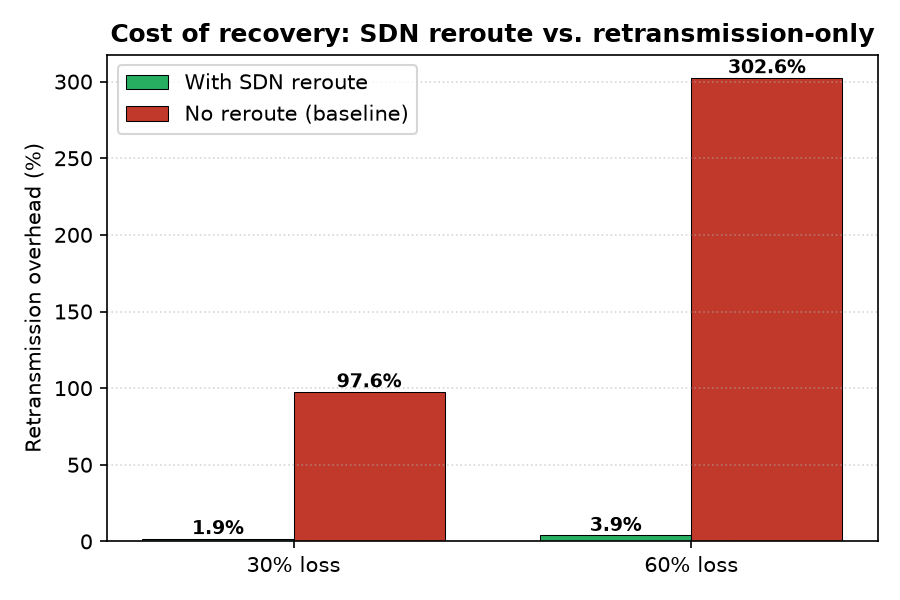
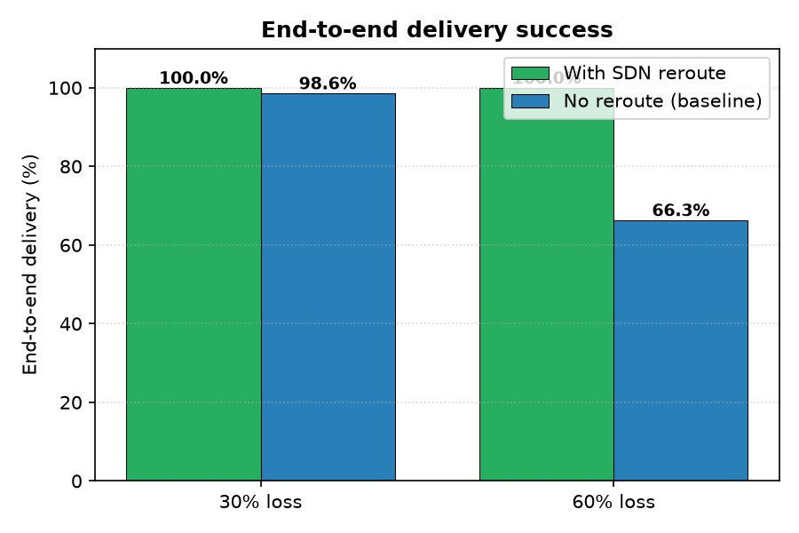
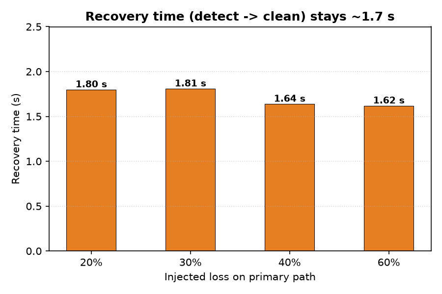
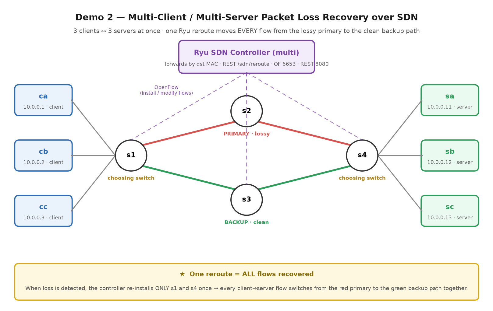
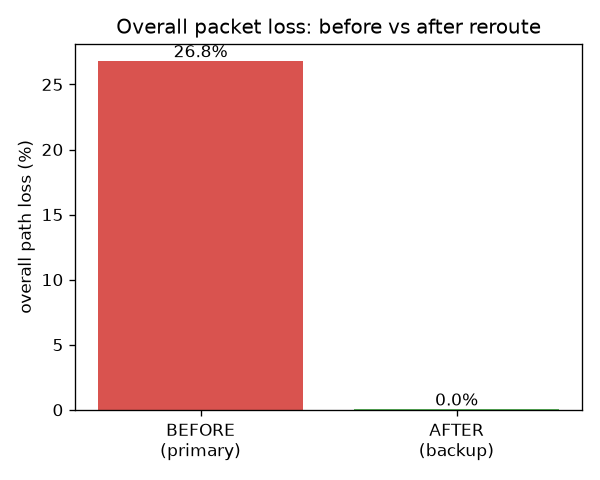

# Packet Loss Detection and Recovery over UDP using SDN

**Project report — Computer Networks**

---

## Abstract

This project implements a UDP application that detects packet loss using
sequence numbers and cooperates with a Software-Defined Networking (SDN)
controller to reroute traffic onto an alternate path when a link becomes lossy.
The system is built and evaluated in Mininet with a Ryu controller. On a
diamond topology with a deliberately lossy primary path, the application detects
loss within a sliding window, requests a reroute through the controller's REST
API, and recovers to near-zero loss on a clean backup path in under 2 seconds.
Across injected loss levels of 20–60%, SDN rerouting maintains **100% end-to-end
delivery** with minimal retransmission overhead, whereas a retransmission-only
baseline collapses to **66% delivery with 302% overhead** at 60% loss.

---

## 1. Problem statement and objectives

UDP is connectionless and unreliable: it provides no sequence numbers, no
acknowledgements and no retransmission, so applications cannot by themselves
tell when packets are lost. The objective is to build, on top of UDP:

1. **Loss detection** using application-level sequence numbers.
2. **Recovery** through two complementary mechanisms:
   - a lightweight reliability layer (acknowledgements + retransmission), and
   - an **SDN-driven reroute** that moves traffic to a better physical path.
3. **Measurement** of packet loss and recovery, comparing before vs. after.

This maps to the required features: UDP sequence tracking, missing-packet
detection, acknowledgements and retransmission, path monitoring, alternate paths
in Mininet, dynamic rerouting, recovery-time measurement, and a before/after
loss comparison.

---

## 2. System architecture



The network is a **diamond** with two disjoint paths between hosts h1 and h2:

- **Primary path:** s1 → s2 → s4 (given artificial packet loss).
- **Backup path:** s1 → s3 → s4 (clean).

Components:

- **UDP sender (h1):** sends numbered packets, keeps an unacknowledged table,
  and retransmits on timeout (a simplified ARQ).
- **UDP receiver (h2):** acknowledges every packet, detects sequence gaps,
  maintains a sliding-window loss ratio, and triggers recovery when loss crosses
  a threshold.
- **Ryu SDN controller:** proactively installs exact-match (destination-MAC)
  forwarding flows for the active path and exposes a REST API to switch paths.
- **Reroute agent (root namespace):** bridges the application's decision to the
  controller (see §3.3).

### Why there is no broadcast storm
The diamond contains a physical loop. Hosts use fixed MACs and **static ARP**,
so no ARP broadcasts occur, and the controller installs only exact unicast
flows — it never floods. With no broadcast traffic, the loop is harmless and no
spanning tree is needed.

---

## 3. Implementation

### 3.1 Reliability layer (mini-protocol)
```
Data (h1→h2):  <seq> | <send_time> | <payload>
Ack  (h2→h1):  ACK | <seq>
End  (h1→h2):  END | END | END
```
The sender transmits each packet with a sequence number, tracks unacknowledged
packets, and a background thread collects ACKs; packets without an ACK within
the timeout are retransmitted up to a retry limit. The receiver ACKs every
packet and detects gaps in the sequence (e.g. seeing 5 then 8 means 6 and 7 are
missing), with a grace period for reordering.

### 3.2 SDN control logic (Ryu)
The controller installs, per switch, output flows keyed on destination MAC for
the active path. Only s1 and s4 choose between primary and backup; s2 and s3
forward straight through. A reroute re-installs the s1/s4 flows to use the backup
ports. REST endpoints: `GET /sdn/status`, `POST /sdn/reroute`, `POST /sdn/primary`.

### 3.3 Integration (app → controller)
Mininet hosts are in isolated network namespaces and cannot reach the
controller's REST port on the root namespace, but they share the filesystem. So
the receiver writes a signal file (`/tmp/reroute.signal`) when it decides to
reroute; a small agent in the root namespace sees it and calls
`POST /sdn/reroute`. This cleanly separates the application *decision* from the
control-plane *action*.

---

## 4. Experimental setup

- **Platform:** WSL2 Ubuntu, Open vSwitch (kernel datapath), Ryu controller
  (OpenFlow 1.3), Mininet diamond topology.
- **Workload:** 2000 UDP packets at 50 packets/second, 200-byte payload.
- **Loss model:** Mininet `TCLink` with `loss=L%` on the primary link; backup
  link clean.
- **Detection:** 100-packet sliding window, reroute threshold 15% loss.
- **Runs:** with reroute at L = 20/30/40/60%, and a no-reroute baseline at
  L = 30/60% for comparison.

---

## 5. Results

### 5.1 Packet loss before vs. after recovery
At 30% loss, path loss falls from **32% to 0%** after the reroute, with a
**1.81 s** recovery time and **100%** end-to-end delivery.



| Primary-path loss | Before reroute | After reroute | Recovery time | Retransmit overhead | Delivery |
|---:|---:|---:|---:|---:|---:|
| 20 % | 23.53 % | 0.00 % | 1.80 s | 1.70 % | 100 % |
| 30 % | 32.00 % | 0.00 % | 1.81 s | 1.85 % | 100 % |
| 40 % | 40.00 % | 0.00 % | 1.64 s | 2.75 % | 100 % |
| 60 % | 48.00 % | 0.15 % | 1.62 s | 3.90 % | 100 % |

### 5.2 SDN reroute vs. retransmission-only baseline



| Metric (at 60% loss) | With SDN reroute | Baseline (no reroute) |
|---|---:|---:|
| Retransmission overhead | **3.90 %** | 302.55 % |
| End-to-end delivery | **100 %** | 66.35 % |
| Throughput (delivered) | **49.7 pkt/s** | 31.6 pkt/s |
| Packets never recovered | 0 | 89 |

Without SDN, the retransmission layer is overwhelmed as loss rises; with SDN it
barely has to work because the reroute removes the cause of loss.

### 5.3 Recovery time


Recovery time stays between **1.6 and 1.8 s** across all loss levels — detection
and rerouting are fast and stable regardless of how bad the primary path gets.

---

## 6. Robustness (challenging scenario)

At an extreme **60%** loss, the system still detects the degradation, reroutes in
**1.62 s**, and recovers to 0.15% loss and 100% delivery. The identical scenario
without rerouting delivers only 66% and permanently loses 89 packets — showing
that the SDN recovery, not retransmission alone, is what makes the application
robust under severe loss.

---

## 7. Conclusion

The project demonstrates a working loss-detection-and-recovery system: UDP
sequence tracking and ACK/retransmission provide per-packet reliability, while
an SDN controller provides path-level recovery by dynamically rerouting around a
lossy link. The combination keeps end-to-end delivery at 100% with negligible
overhead across a wide range of loss conditions, and recovers within ~1.7 s.
Possible extensions: controller-driven detection via port statistics, dynamic
path computation from a discovered topology, and automatic fail-back to the
primary path once it recovers.

---

## 8. How to run

See `../README.md` for full setup. In short:

```bash
# Terminal 1 (controller):
~/ryu-venv/bin/ryu-manager ryu_controller.py

# Terminal 2 (experiment):
sudo python3 run_demo.py --loss 30 --count 2000 --rate 50
```

Source files: `udp_sender.py`, `udp_receiver.py`, `ryu_controller.py`,
`topology.py`, `reroute_agent.py`, `reroute_client.py`, `run_demo.py`.
Design detail in `ARCHITECTURE.md`; viva preparation in `VIVA.md`; full result
tables in `RESULTS.md`.

---

## 9. Deliverable 2 Extension — Multi-Client / Multi-Server Scaling

The system above was extended for Deliverable 2 to run **multiple clients and
servers concurrently** and to collect full **statistics** across all of them,
demonstrating that the SDN-based recovery scales: a single reroute recovers every
flow at once.

### 9.1 Design
Three clients (ca, cb, cc) each communicate with their own server (sa, sb, sc) at
the same time, all sharing the one diamond network. The three client–server
sessions are independent reliable-UDP flows (each with its own sequence numbers,
ACKs and retransmission), but they all ride the same lossy primary link — so they
experience loss together and all benefit from the same reroute. Clients connect to
s1 and servers to s4; the controller (`ryu_controller_multi.py`) forwards by
destination MAC, and the primary/backup choice depends only on the direction of
travel, not on which host it is.



### 9.2 Why one reroute recovers all flows
Because the forwarding rule is identical for every host, re-installing the flows on
only the two path-choosing switches (s1 and s4) **once** moves every flow onto the
clean backup path at the same instant. One control action recovers all flows — the
advantage of doing recovery in the SDN control plane rather than per-connection.
Adding more clients/servers is just more flow entries; the path logic is unchanged
and the reroute cost stays constant.

### 9.3 Statistics collected
Each sender and receiver writes a JSON summary of its flow; `collect_stats.py`
aggregates them into a per-flow table, an aggregate summary, and an overall
before-vs-after comparison, plus bar charts. Every value comes straight from the
programs — nothing is typed by hand.

### 9.4 Results (3 concurrent flows, 30% primary loss)

| Flow | Delivery | Retx overhead | Loss before | Loss after | Recovery |
|---|---:|---:|---:|---:|---:|
| ca → sa | 100.0 % | 1.6 % | 21.57 % | 0.00 % | 1.84 s |
| cb → sb | 100.0 % | 1.4 % | 20.00 % | 0.15 % | 1.88 s |
| cc → sc | 100.0 % | 1.2 % | 18.00 % | 0.00 % | 1.64 s |

**Aggregate (all 3 flows):** 6000 sent, 6000 delivered = **100% delivery**, 84
retransmissions (**1.40% overhead**), 0 packets never recovered, recovery avg
**1.79 s** / worst 1.88 s (3/3 flows recovered).

| Phase | Packets sent | Packets lost | Path loss |
|---|---:|---:|---:|
| BEFORE (lossy primary) | 151 | 30 | **19.87 %** |
| AFTER (clean backup) | 5882 | 3 | **0.05 %** |

Overall path loss dropped from **19.87% to 0.05%** (≈20 percentage points) after a
single reroute, with all flows keeping 100% delivery. The small 0.05% after is a
few packets caught at the instant of the switch (recovered by retransmission); the
backup link itself is clean.



### 9.5 How to run
```bash
# Terminal 1 (controller):
~/ryu-venv/bin/ryu-manager ryu_controller_multi.py

# Terminal 2 (experiment):
sudo python3 run_demo_multi.py --loss 30 --count 2000 --rate 50
```
Source files: `ryu_controller_multi.py`, `run_demo_multi.py`, `topology_multi.py`,
`collect_stats.py`, plus shared `udp_sender.py` / `udp_receiver.py` /
`reroute_agent.py`. Presentation/viva material: `D2_PRESENTATION.docx`,
`D2_COMPLETE_GUIDE.docx`, `D2_CONCEPT_TO_CODE.docx`.
